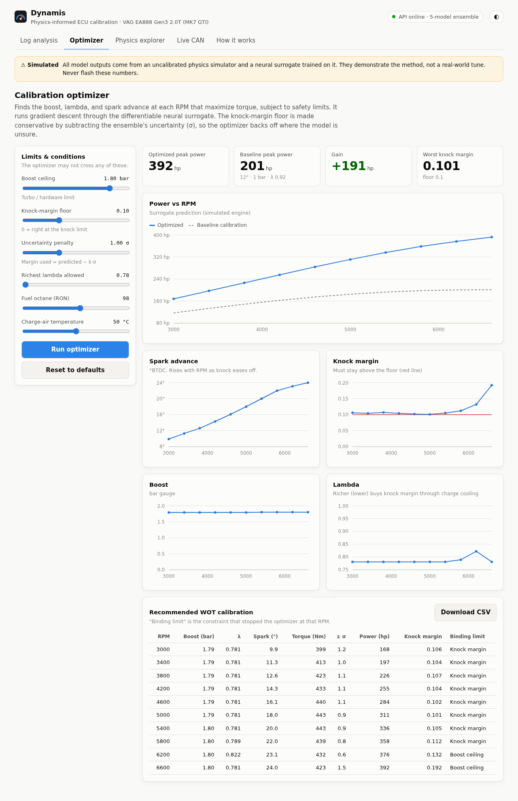
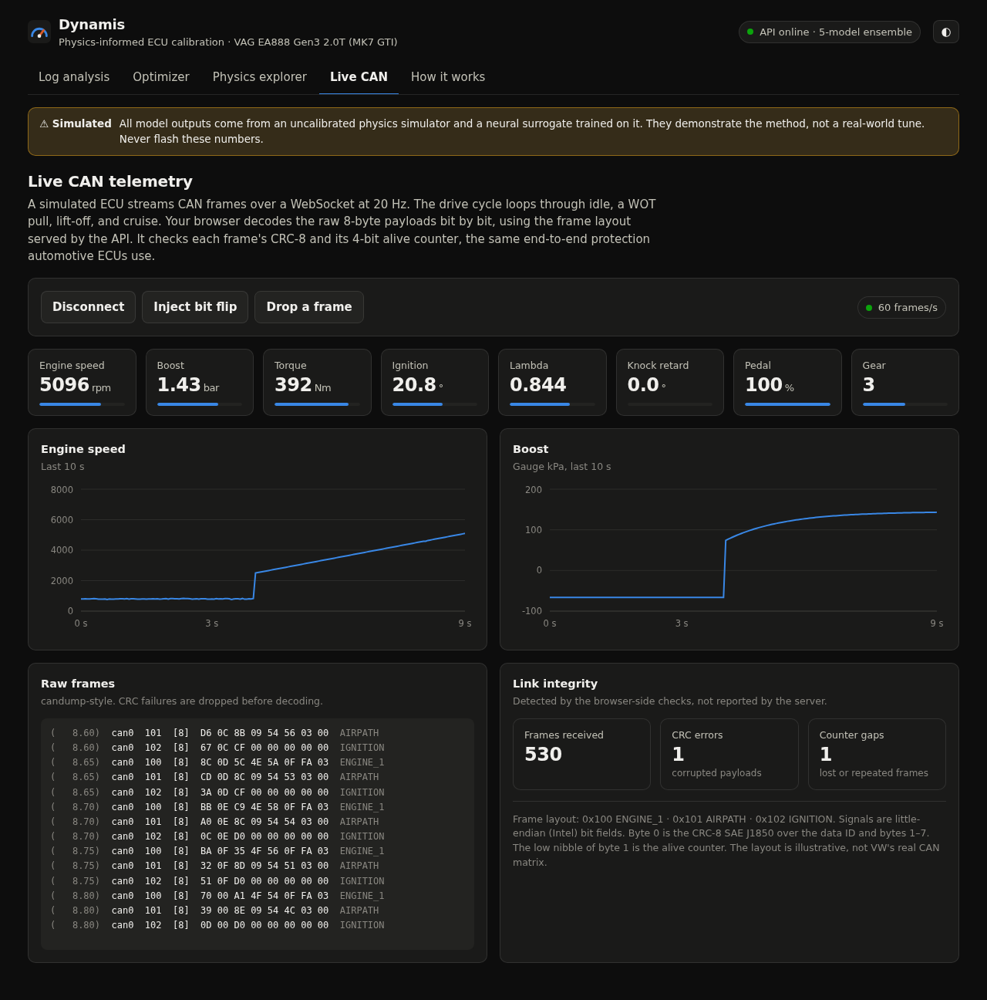
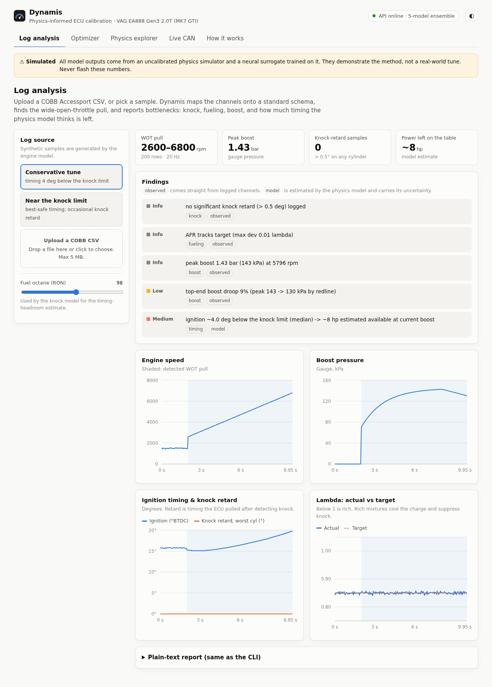
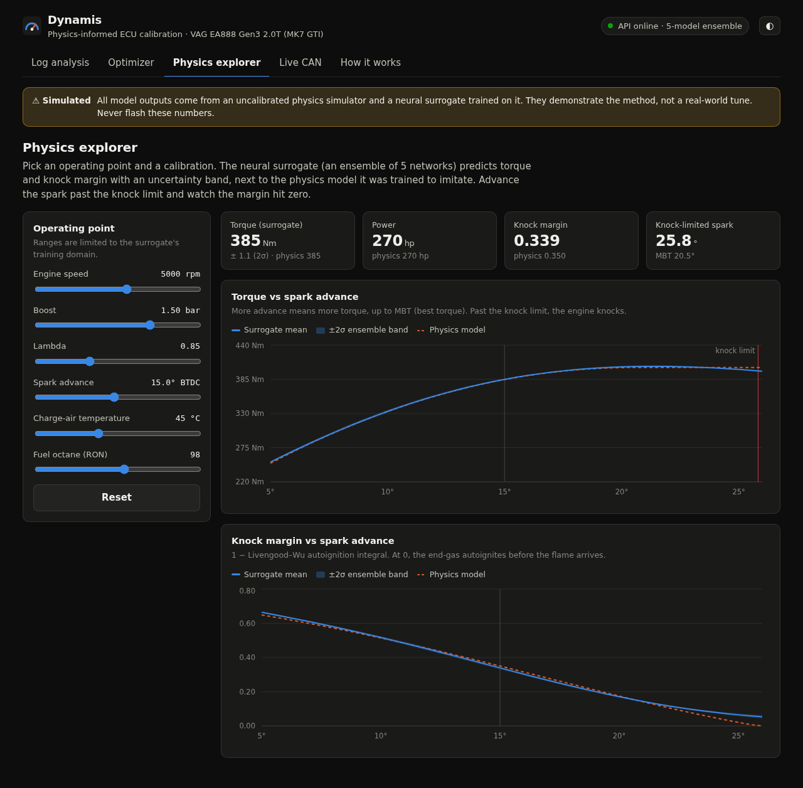

# Project Dynamis

> Working codename — rename freely. *Dynamis* (δύναμις, "power / potential").

An automated, **physics-informed** engineering pipeline that analyzes vehicle ECU
data logs and calibration maps, learns the underlying engine physics, and proposes
**optimized calibration adjustments** to improve performance — bounded at every step
by hard safety limits and kept human-in-the-loop.

## Status

🟢 **v1 pipeline running on simulated data.** The full spine is built and tested —
physics → data → calibration → surrogate (+uncertainty) → constrained optimizer.
Training currently runs on **simulator-generated** data; calibrating against real
EA888 logs (the M3 anchor) is the remaining step to make outputs trustworthy.
Design: [`docs/ARCHITECTURE.md`](docs/ARCHITECTURE.md).

## Web demo

The pipeline is also served as a full-stack web app, self-hosted from a home PC:

| | |
|---|---|
|  |  |
|  |  |

- **Log analysis.** Upload a COBB CSV. You get the WOT pull, findings (observed vs model-estimated), and channel charts.
- **Optimizer.** The constrained optimizer runs as a background job, with live progress over **Server-Sent Events**.
- **Physics explorer.** Sliders query the surrogate ensemble (mean ± 2σ) next to the physics model it imitates.
- **Live CAN.** A simulated ECU streams 8-byte CAN frames over a **WebSocket** at 20 Hz. The browser decodes the
  bit fields itself and checks each frame's **CRC-8 (SAE J1850)** and **alive counter**. Use the fault-injection
  buttons to see both checks catch errors.

**Stack:** FastAPI + uvicorn (`src/dynamis/api/`) · React + TypeScript + Vite + Recharts (`frontend/`) ·
Caddy (static files, reverse proxy, TLS, security headers) · Docker Compose · ingress through a **Cloudflare Tunnel**
(outbound-only, works behind NAT) *or* **direct** via router port forwarding + dynamic DNS + Let's Encrypt.

```bash
.venv/bin/dynamis train --out models/surrogate.pt   # once: the model the API serves
docker compose up -d --build                          # -> http://localhost:8080
```

Going public (domain, tunnel, port forwarding, DNS) is covered step by step in [`deploy/DEPLOY.md`](deploy/DEPLOY.md).

## The one-paragraph idea

Clean, paired `(map-change → outcome)` datasets barely exist online, so we don't try to
learn tuning end-to-end from scraped logs. Instead we build a **differentiable, mean-value
engine model** (physics for structure), **anchor it to abundant real wide-open-throttle
logs** (data for the residuals), and then **optimize *through* that model** under safety
constraints to find calibration changes that increase performance. The first version
targets **steady-state peak power** on **VAG EA888 (MK7 GTI/Golf R)**.

## Scope at a glance (v1)

| Dimension      | v1 choice                                                            |
|----------------|---------------------------------------------------------------------|
| Data           | Simulator-first; real WOT logs as calibration/validation anchor     |
| Simulator      | Differentiable Python mean-value engine model (gray-box)            |
| Model          | Physics-informed forward model, **inverted via constrained optimization** |
| Objective      | Steady-state **peak power** (WOT)                                    |
| Platforms      | **VAG EA888 (MK7 GTI/Golf R)** — v1 target; N55 secondary           |
| Output         | **Advisory** map-change recommendations + confidence (no auto-flash) |

## Development

Python 3.10+, isolated venv. PyTorch uses the **CUDA 12.8** wheel (Blackwell / RTX 50-series; CPU-only also fine).

```bash
python3 -m venv .venv --without-pip                       # system python may lack ensurepip
curl -fsSL https://bootstrap.pypa.io/get-pip.py | .venv/bin/python
.venv/bin/pip install torch --index-url https://download.pytorch.org/whl/cu128   # omit for CPU-only
.venv/bin/pip install -e ".[ml,web,dev]"
.venv/bin/python -m pytest -q
```

Web app in development mode (hot reload; Vite proxies `/api` to uvicorn):

```bash
.venv/bin/uvicorn dynamis.api.app:create_app --factory --reload --port 8000
cd frontend && npm ci && npm run dev                  # -> http://localhost:5173
```

## Usage

After the install above, the `dynamis` CLI is available in the venv. `train`/`optimize`
import PyTorch lazily; `ingest`/`diagnose`/`add-log` don't need it.

> Training/optimization currently use **simulator-generated** data (simulator-first). They
> validate the machinery and are *not* a substitute for real-data calibration — see Status.

```bash
# generate a synthetic COBB-style WOT log to try the tool
# (--spark-offset -4 leaves timing on the table; omit for an "optimal" tune)
.venv/bin/dynamis make-synthetic --out data/synthetic/demo.csv --spark-offset -4

# ingest + QA a log   /   diagnose it for bottlenecks
.venv/bin/dynamis ingest   data/synthetic/demo.csv
.venv/bin/dynamis diagnose data/synthetic/demo.csv

# train the surrogate once (saved), then optimize a tune from it
.venv/bin/dynamis train    --out models/surrogate.pt
.venv/bin/dynamis optimize --model models/surrogate.pt --boost-max 1.8 --knock-margin 0.10

# add a real log to the curated corpus
cp configs/metadata_template.yaml mylog.yaml          # fill in fuel / mods / source
.venv/bin/dynamis add-log mylog.csv mylog.yaml

.venv/bin/dynamis --help                              # all commands
.venv/bin/python -m pytest -q                         # tests
```

The standalone `scripts/*.py` demos (e.g. `calibrate_demo.py`, `optimize_demo.py`) remain
for stage-by-stage exploration and also run with `PYTHONPATH=src python3 <script>`.

## Example — optimizer output

`scripts/optimize_demo.py` (surrogate trained on **simulator** data — see Status) produces
a recommended WOT calibration across the RPM sweep (abridged):

```text
=== recommended WOT calibration (98 RON, 50°C charge) ===
 rpm  boost_bar  lambda  spark_deg  torque_nm  power_hp  knock_margin  active_limit
3000       1.79   0.781        9.9        399       168         0.106  knock
3800       1.79   0.781       12.6        423       226         0.107  knock
4600       1.79   0.781       16.1        440       284         0.103  knock
5400       1.80   0.781       19.9        443       336         0.106  knock
5800       1.80   0.789       22.2        439       358         0.107  knock
6200       1.80   0.822       23.1        432       376         0.132  boost ceiling
6600       1.80   0.781       24.0        423       392         0.192  boost ceiling

peak power: 392 hp   baseline: 201 hp   gain: +191 hp
min knock margin across sweep: 0.103  (limit 0.10)
```

The interesting part is the *reasoning*, not the numbers:
- **boost → ceiling (1.8 bar)** everywhere (maximize air);
- **λ → rich limit (~0.78)** for charge cooling, which buys ignition timing;
- a **knock-limited timing schedule rising 10° → 24°** with RPM;
- the **binding constraint flips `knock` → `boost ceiling`** up top, where knock margin opens up;
- **knock margin held ≥ 0.10** across the sweep (safety as a hard constraint);
- **+191 hp** vs a conservative baseline.

> ⚠️ These numbers come from the **uncalibrated simulator**, so they demonstrate the
> machinery — not a real-world tune. Trustworthy output requires the M3 real-data calibration.

## Intended use & boundaries

Off-road / track / dyno / research use. Recommendations are advisory and require
human + dyno validation before anything is flashed. No emissions-control-defeat
functionality. See [Safety, Legal & Ethics](docs/ARCHITECTURE.md#12-safety-legal--ethics).
